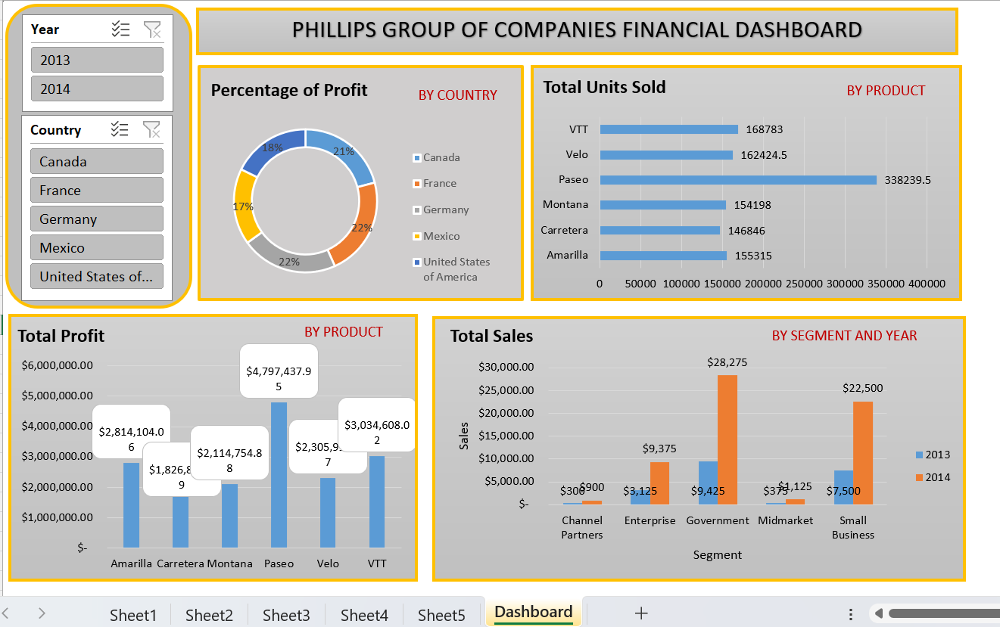
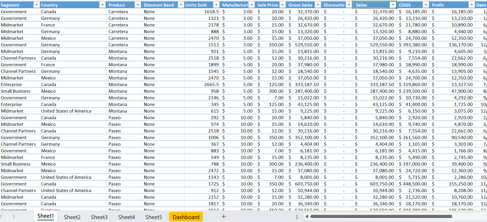
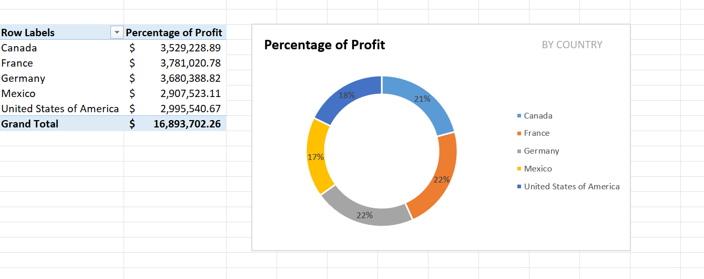
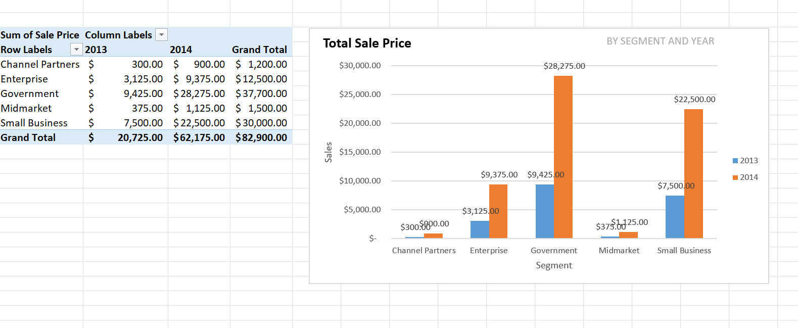
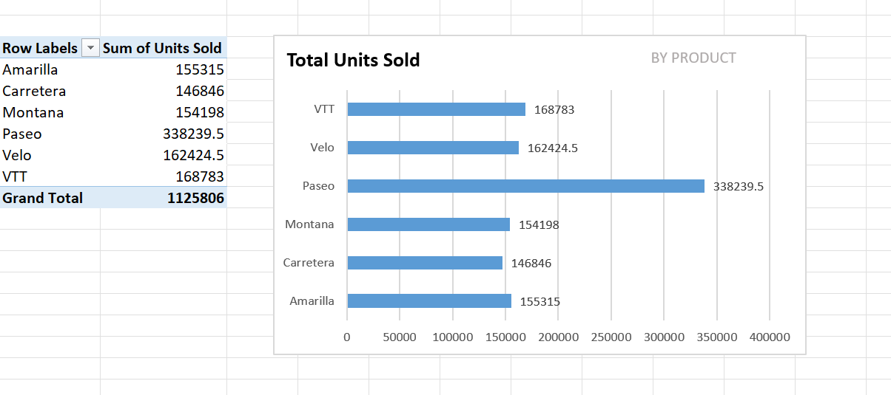
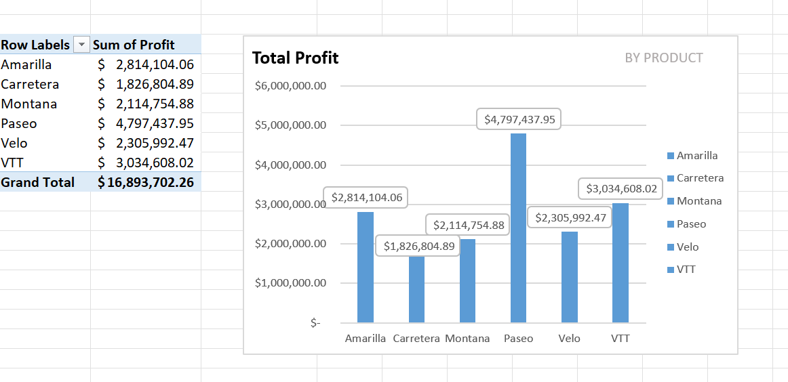

# Corporate Financial Performance Dashboard (Excel & Power Query)

## 📌 Project Overview
This project delivers a comprehensive financial intelligence solution engineered to analyze global sales, profit structures, and product distributions for **Phillips Group of Companies**. 

Using a robust data pipeline, the project transforms raw, multi-national transaction logs into a clean relational structure. It aggregates performance across several countries (**Canada, France, Germany, Mexico, and the United States**) and segments to empower stakeholders with interactive, executive-level decision-making metrics.

---

## 🛠️ Tech Stack & Advanced Features Used
*   **Power Query (ETL):** Executed data ingestion, type casting, schema standardization, and conditional cleaning steps to prepare the raw financial ledger.
*   **Data Modeling & Pivot Tables:** Built decoupled calculation matrices across independent sheets (`Sheet2` through `Sheet5`) to isolate metric aggregations from the presentational layer.
*   **Analytical Formulations:** Calculated multi-dimensional financial variables including Gross Sales, Cost of Goods Sold (COGS), and net Margin Percentages.
*   **UI/UX Dashboard Architecture:** Designed an intuitive control layout utilizing corporate color synchronization, thematic hierarchy, and interactive temporal/regional **Slicers**.

---

## 📐 Data Pipeline Architecture

The application utilizes a classic 3-tier business intelligence architecture to maintain processing speed and system isolation:

[Raw Ledger Data] ──► [Power Query ETL Engine] ──► [Hidden Pivot Matrices] ──► [Executive Dashboard]
1.  **Extract & Clean (`Sheet1`):** Raw metrics undergo structural formatting and attribute cleansing via Power Query.
2.  **Transform & Aggregate (`Sheets 2-5`):** Independent pivot architectures calculate specific operational metrics without overlapping dependencies.
3.  **Load & Visualize (`Dashboard`):** Interactive visualization panes bind calculation layers to a central master canvas controlled by global filters.

---

## 🚀 Analytical Breakdowns & Features

### A. Data Cleansing & Normalization (Power Query)
Before visual mapping, the underlying transactional data was processed to resolve schema inconsistencies, verify monetary value scales, format calendar timelines (`Date`), and isolate structural calculation fields (Units Sold, Sale Price, COGS, and Profit).

### B. Core Metric Tracking Sheets
*   **Profit Distribution by Geography (`Sheet2`):** Aggregates total global net revenue to isolate top geographic performance pockets.
*   **Sales Lifecycle by Segment & Timeline (`Sheet3`):** Compares annualized sales shifts across distinct demographic targets (Government, Small Business, Enterprise, etc.) between 2013 and 2014.
*   **Volume Velocity by Product SKU (`Sheet4`):** Tracks inventory consumption speeds by recording cumulative item counts sold per product line.
*   **Net Profit Contribution by SKU (`Sheet5`):** Pinpoints distinct financial anchors by mapping total profits directly back to individual product categories.

---

## 📊 Project Visual Gallery

### 1. Executive Financial Dashboard

### 2. Cleaned Production Data Ledger (Sheet 1)

### 3. Profit Percentage Matrix by Country (Sheet 2)

### 4. Sales Distribution by Segment & Year (Sheet 3)

### 5. Aggregate Product Units Sold (Sheet 4)

### 6. Profit Contribution by Product Line (Sheet 5)

---

## 💡 Key Business Insights Discovered
1. **Regional Profit Stability:** Profit margins remain evenly distributed among core operating countries, with France leading marginally at **22%**, indicating highly balanced international market health.
2. **Product Superstars:** The **Paseo** product line acts as the company's core financial engine, driving both peak inventory movement (**338,239+ units sold**) and peak bottom-line profits (**\$4.79M+**).
3. **High-Growth Segments:** The **Government** procurement sector represents the fastest-growing revenue stream, scaling significantly from 2013 to over **\$28,275** in relative sales brackets by 2014.
